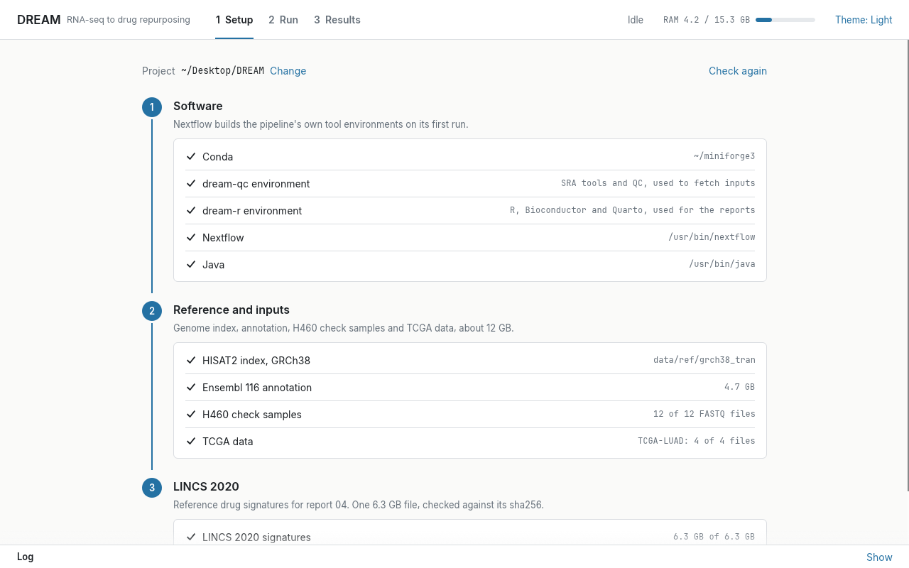
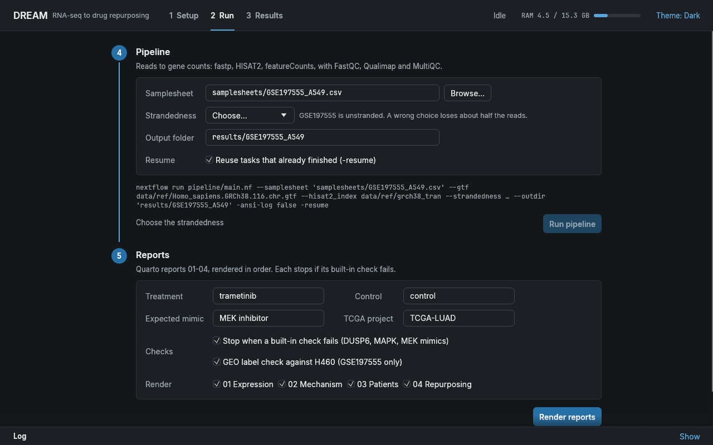

# DREAM

**Drug Repurposing via Expression Analysis & Mapping**: an end-to-end RNA-seq project that starts from raw reads in GEO and ends with patient validation and a drug-repurposing query.

[](https://github.com/TanmayAloorkar/DREAM/actions/workflows/ci.yml)

The worked example is [GSE197555](https://www.ncbi.nlm.nih.gov/geo/query/acc.cgi?acc=GSE197555): A549 lung adenocarcinoma cells (KRAS G12S) treated with the MEK inhibitor trametinib versus DMSO, three replicates each.

| Step | What it does | Report |
|---|---|---|
| Pipeline | SRA download, fastp, HISAT2, featureCounts, FastQC, Qualimap, MultiQC (Nextflow DSL2) | [MultiQC](https://tanmayaloorkar.github.io/DREAM/multiqc_A549.html) |
| 1. Differential expression | DESeq2 with apeglm shrinkage, Hallmark GSEA, GO and KEGG | [01](https://tanmayaloorkar.github.io/DREAM/01_differential_expression.html) |
| 2. Mechanism | Pathway (PROGENy) and transcription factor (CollecTRI) activity with decoupleR | [02](https://tanmayaloorkar.github.io/DREAM/02_mechanism.html) |
| 3. Patients | Signature scored in TCGA lung adenocarcinoma: drivers, survival, random-set control | [03](https://tanmayaloorkar.github.io/DREAM/03_patients.html) |
| 4. Drug repurposing | Connectivity query against LINCS 2020 (136,460 compound signatures) with signatureSearch | [04](https://tanmayaloorkar.github.io/DREAM/04_drug_repurposing.html) |

The rendered reports are in `docs/` and published with GitHub Pages at [tanmayaloorkar.github.io/DREAM](https://tanmayaloorkar.github.io/DREAM/). To refresh them, copy `analysis/0*.html` into `docs/` and replace your home directory path in the session info.

## Findings

- **The GEO labels for the A549 samples appear to be swapped.** Every classic ERK target is higher in the samples labelled trametinib. The H460 samples from the same series behave as expected, which points to the labels rather than the pipeline. No correction has been published, so this is an inference from the data. The correction and the evidence are in [samplesheets/README.md](samplesheets/README.md) and report 01.
- **Trametinib shuts down the MAPK pathway and triggers a PI3K escape.** 3,516 genes change (padj < 0.05, |log2FC| > 1). PROGENy MAPK activity falls the most of all 14 pathways, while PI3K rises, the known feedback that motivates MEK + PI3K combinations.
- **The core ERK programme is visible in patients, but it does not predict survival.** In 503 TCGA-LUAD tumours the 10-gene MAPK Pathway Activity Score is higher in KRAS- and EGFR-mutant tumours. Neither it nor the broader 200-gene signature is linked to overall survival, and the broad signature does no better than random gene sets.
- **The drug query recovers the drug.** MEK inhibitors are the top mimics among 13,205 LINCS compounds, including trametinib itself. Vemurafenib and dabrafenib reverse the signature, as their paradoxical ERK activation predicts. Among approved drugs, glucocorticoids are the strongest non-MAPK mimics, a hypothesis to test rather than a recommendation.

Each report stops with an error if its built-in check fails (for example, DUSP6 not falling, or MEK inhibitors not ranking as mimics), so a rendered report has passed its own sanity check.

## Running it

Requirements: Linux, [Miniforge](https://github.com/conda-forge/miniforge), Nextflow 26.04 (the version CI tests), Java 17+, `aria2c` (optional, much faster downloads).

```bash
# 1. Environments (Nextflow builds dream-qc and dream-align itself; the reports need dream-r)
mamba env create -f envs/qc.yml
mamba env create -f envs/r.yml

# 2. Reference, H460 check samples and TCGA data (~12 GB), then LINCS 2020 (6.3 GB)
conda activate dream-qc
scripts/get_inputs.sh
scripts/download_lincs.sh

# 3. Pipeline (downloads the SRA runs itself); commands for both sample sets are in samplesheets/README.md
nextflow run pipeline/main.nf --samplesheet samplesheets/GSE197555_A549.csv \
  --gtf data/ref/Homo_sapiens.GRCh38.116.chr.gtf --hisat2_index data/ref/grch38_tran \
  --strandedness unstranded --outdir results/GSE197555_A549

# 4. Reports, in order (each reads the previous one's results)
cd analysis
for q in 01_differential_expression 02_mechanism 03_patients 04_drug_repurposing; do
  conda run -n dream-r --no-capture-output quarto render $q.qmd
done
```

### Desktop app

`gui/` holds a small Rust desktop app (egui) that does the same steps from a window: it checks the software and inputs, offers to create the environments and download what is missing, runs the pipeline and the reports with the right options, streams the log, and opens the finished reports. It runs one job at a time and shows memory use, so a 15 GB laptop is not overloaded. Light and dark themes follow the system setting, or can be switched from the top bar.




Linux only. Build it with Rust (stable) and run it from the repo, or download `dream-gui-linux-x86_64` from the latest CI run:

```bash
cd gui && cargo build --release
./target/release/dream-gui
```

The result is a single 14 MB executable; it remembers the DREAM folder you choose.

A quick check of the pipeline on simulated data (a few minutes, also run by CI on every push):

```bash
nextflow run pipeline/main.nf -profile test && python tests/check_counts.py results/test
```

### Using it on another dataset

- **Samplesheet:** columns `sample`, `run` (SRA accession) or `fastq_1`/`fastq_2` (local files), and `condition`. See `samplesheets/`.
- **Pipeline:** `--strandedness` is required (`unstranded`, `forward` or `reverse`). Check the assigned fraction in the MultiQC featureCounts section if unsure.
- **Reports:** pass parameters with `-P`, for example `quarto render 01_differential_expression.qmd -P treatment:drugX -P control:dmso -P label_check:false -P gate_direction:none`. The main parameters:
  - 01: `treatment`, `control`, `label_check` (GSE197555 only), `markers`, `gate_gene`, `gate_direction` (`down`, `up` or `none`).
  - 02: `treatment`, `control`, `gate_pathway`, `gate_direction`.
  - 03: `tcga_project` (fetch with `TCGA_PROJECT=TCGA-BRCA scripts/get_inputs.sh`), `driver_genes`, `gate_pathway`, `workers`.
  - 04: `treatment`, `positive_control_moa` (a LINCS mechanism such as `EGFR inhibitor`).
  - All: input paths and `outdir`.

The "Reading" paragraphs and titles describe the GSE197555 results and need rewriting for a new dataset. The MPAS section in 03 is specific to MAPK pathway drugs.

## Hardware

Developed and run on a laptop with 15 GB RAM and 22 threads.

- **Memory:** HISAT2 with the human index needs about 8 GB, so at least 12 GB of RAM is needed. The pipeline caps itself at 13 GB and 22 CPUs (`pipeline/nextflow.config`). On a smaller machine, override with a config file passed as `-c`:

  ```groovy
  process.resourceLimits = [cpus: 8, memory: 12.GB]
  executor { cpus = 8; memory = '12 GB' }
  ```

- **Disk:** about 30 GB for inputs and results, plus up to 60 GB of intermediate files in `work/` during a full run (`nextflow clean -f` afterwards).
- **One heavy job at a time:** run the pipeline and the reports one after another, not in parallel.

## Layout

```
pipeline/     Nextflow workflow, modules and config
envs/         pinned conda environments
samplesheets/ sample sheets and the label correction notes
analysis/     Quarto reports; resources/ holds the PROGENy and CollecTRI networks used
scripts/      input downloads with checksums
results/      analysis tables and figures (alignments and raw counts are not tracked)
docs/         rendered reports
tests/        simulated test data and the count check used by CI
gui/          Rust desktop app (egui) that runs the steps above
```
